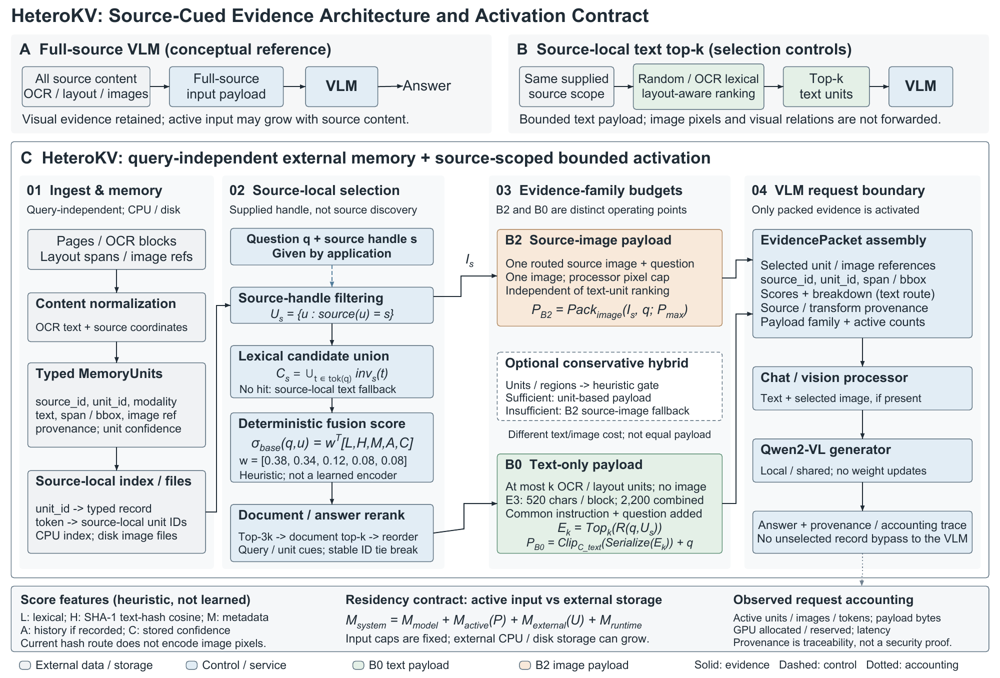

# HeteroKV: source-cued bounded evidence packing

Materials for **HeteroKV: Provenance-Tracked Bounded Evidence Packing for
Source-Cued Cloud Document QA**. This repository publishes the author manuscript
dated **2026-10-11**, its implementation snapshot, native vector architecture,
audited E1--E4 tables, and sanitized derived evaluation records.
It does not assert that the manuscript has been accepted or published.



## Read first

- [Latest paper PDF](paper/main.pdf), [LaTeX](paper/main.tex), [bibliography](paper/references.bib).
- [Step-by-step method](docs/METHOD.md) and [reproduction guide](docs/REPRODUCIBILITY.md).
- [Dataset access, licenses and exact slices](docs/DATA_AVAILABILITY.md).
- [Evidence and claim boundaries](docs/EVIDENCE_SCOPE.md).
- [Paper tables](paper/tables/) and [public run manifest](results/run_manifest.json).
- [Checksums](SHA256SUMS.txt), [release manifest](release_manifest.json),
  [validation](PUBLIC_VALIDATION.json), [release notes](docs/RELEASE_NOTES.md).

## What is implemented

1. Ingest visible OCR/layout/image references into typed, provenance-tracked units.
2. Filter units using an application-supplied source handle.
3. Rank source-local text evidence using deterministic lexical/hash/layout features.
4. Pack **B0** bounded text units or **B2** one bounded source image plus the question.
5. Invoke an unchanged Qwen2-VL and retain quality/resource/provenance traces.

B2 bypasses the text ranker. Its image payload is **not equal-payload** with B0.
The optional hybrid is heuristic and usually falls back to the source image.
This is not a new KV-attention kernel, learned dense retriever, solved no-source
discovery, full-context equivalence, or constant-total-memory system.

## Latest evidence, not historical pilot numbers

| Evidence | Setting | Observed result | Important qualification |
| --- | --- | --- | --- |
| E1 | 20 fixed questions/dataset; endpoint repeats = 3 | DocVQA candidate units 20 -> 100; TextVQA 10 -> 30 | Source-local 5x/3x, not historical 50x/100x source-pool growth |
| E2 | First 1,000 DocVQA / 2,000 TextVQA | ANLS 0.8742 / local soft VQA 0.7848 | Image fallback 99.9% / 99.1%; not crop-only success |
| E3 | Paired first-500 controls | See table below | Text methods share caps, not identical realized bytes |
| E4 | 3 fresh services; concurrency 1/2/4/8 | B0/B2 at concurrency 8: 26.971 / 6.198 req/s | Preselected packets; retrieval excluded; NVML about 34.9--36.1 GiB |

| Dataset / local QA | Random text | OCR lexical | Layout | HeteroKV B0 | B2 image |
| --- | ---: | ---: | ---: | ---: | ---: |
| DocVQA | 0.2480 | 0.4280 | 0.4520 | 0.4180 | 0.8400 |
| TextVQA | 0.3580 | 0.3720 | 0.3740 | 0.3827 | 0.7893 |

DocVQA E3 QA is normalized exact or 5%-numeric matching; TextVQA is simplified
soft VQA, **not official leaderboard evaluation**. The historical code identifier
`bm25_ocr` is an OCR-lexical heuristic, **not standard BM25**. B0 does not
consistently beat lexical/layout controls. Published CSVs contain exact precision,
paired intervals and resource measurements; the rounded table above is an overview.

## CPU-only quick start

```bash
python -m pip install -r requirements-public.txt
python scripts/validate_public_release.py
python -m pytest -q
python scripts/recompute_public_results.py --output outputs/public_reanalysis.json
```

These commands do not load a model, download a benchmark or start a GPU/API job.
GPU reproduction is **opt-in**, after obtaining datasets and a model checkpoint;
see [the guide](docs/REPRODUCIBILITY.md).

## Public data policy

Included: derived run-level/per-request numeric records, model predictions,
sample IDs/signatures, source hashes and synthetic fixtures. Excluded: original
DocVQA/TextVQA images, complete OCR/page text, gold annotation files, model weights,
credentials, server access helpers and private experiment logs. Dataset acquisition
instructions and a terms-confirmation/verification script are included instead.

## License and citation

The authors have chosen **public access without an MIT/open-source license for
now**. Public visibility is not a blanket reuse license. See
[LICENSE_STATUS.md](LICENSE_STATUS.md); third-party rights remain separate.
Use [CITATION.cff](CITATION.cff) for the unpublished author manuscript.

## 中文说明

这是最新论文的公开材料仓库，包含论文 PDF/LaTeX、方法源码、可编辑矢量图、
E1--E4 结果与脱敏逐条统计、数据集获取和复现说明。它不是原始数据集镜像。
原始图片、OCR 全文和标注需按数据集官方规则自行获取。
当前主结论是已知来源条件下的质量与资源权衡，不是无提示检索已解决，
也不是与完整上下文问答等价。代码暂未授予 MIT 或其他开源许可。
